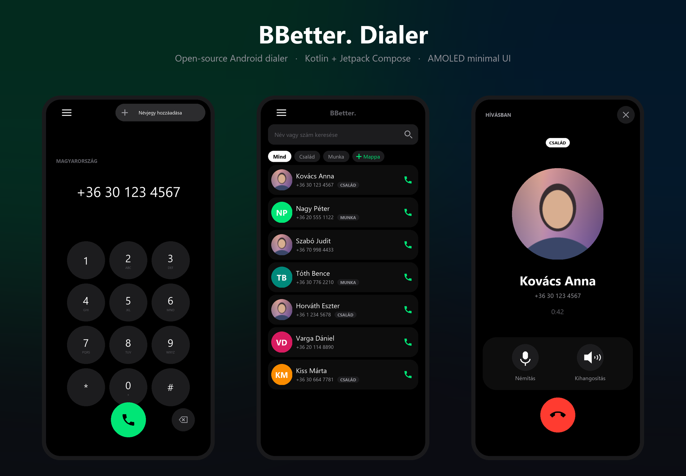
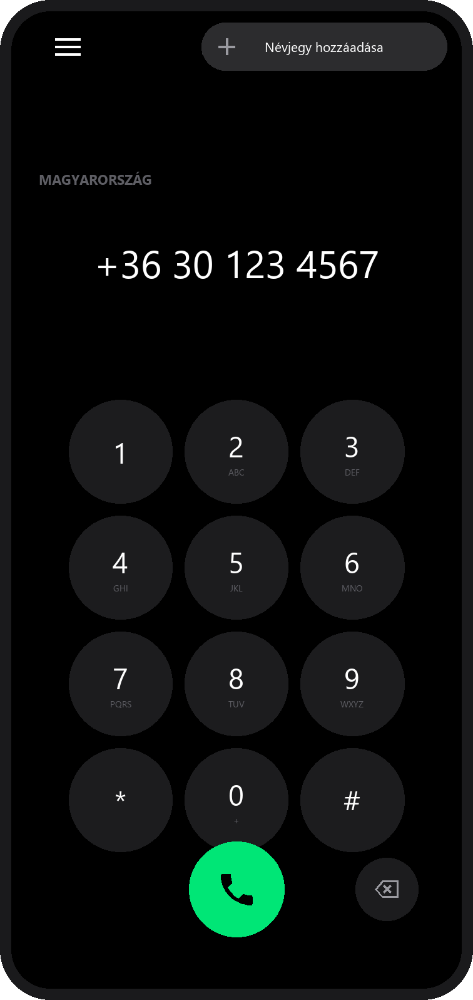
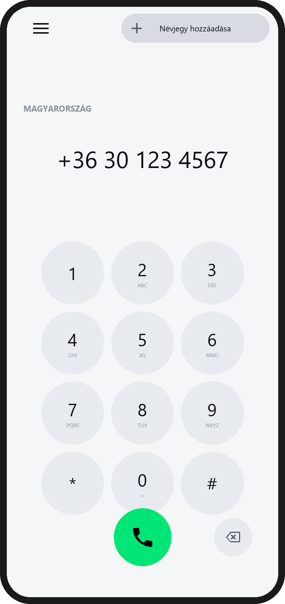
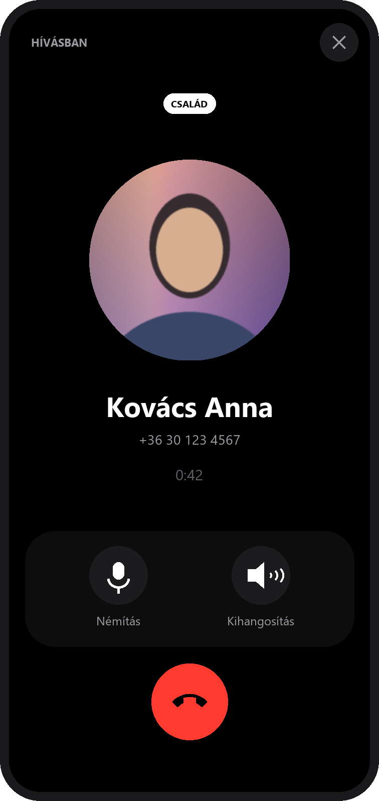
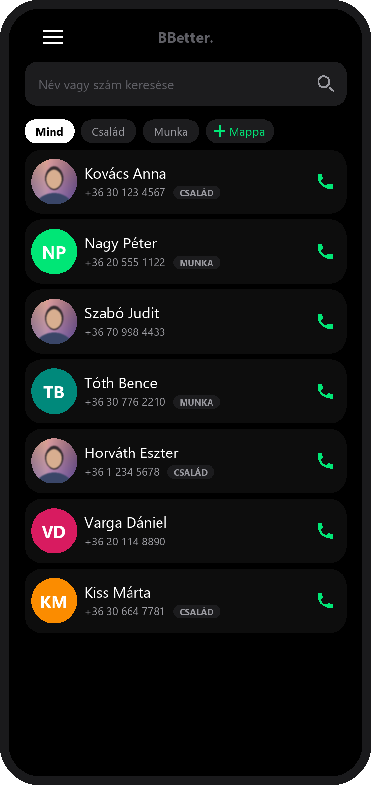
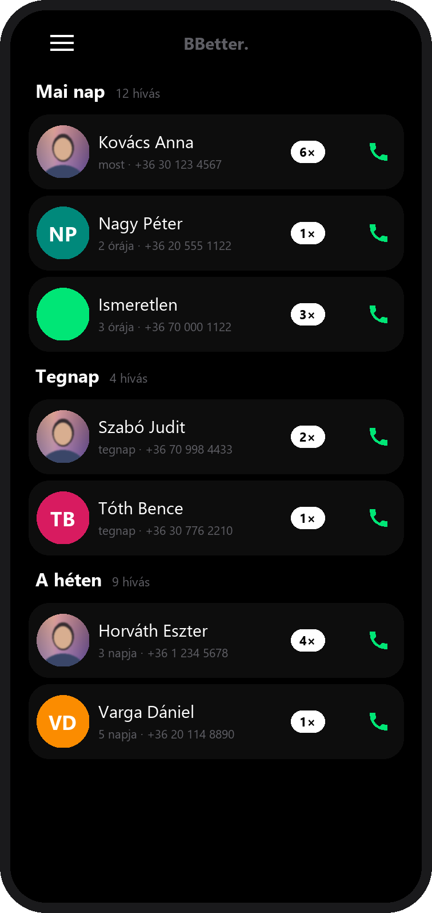
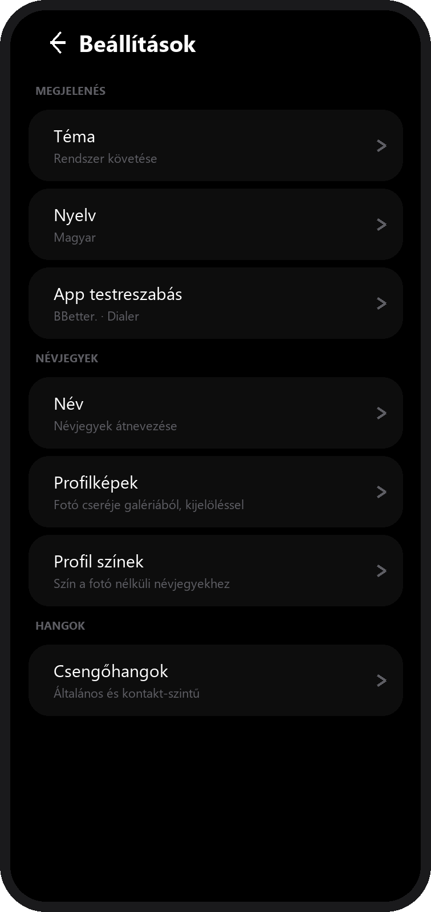

<div align="center">
  
</div>

<h1 align="center">BBetter. Dialer</h1>

<p align="center">
  <b>A fast, minimal, open-source Android dialer</b><br>
  Kotlin · Jetpack Compose · AMOLED-first design · no bloat, no ads, no tracking
</p>

<p align="center">
  <a href="LICENSE"></a>
  
  
  
  
</p>

---

## The vision — a complete BBetter. ecosystem

**BBetter. Dialer is the first piece of a bigger plan: building an ecosystem of
small, fast, privacy-respecting everyday apps under the `BBetter.` name.**

The idea is simple. Modern phone apps got heavy — dozens of permissions, ads,
telemetry, hundreds of megabytes, interfaces fighting for your attention.
BBetter. goes the opposite way. Every app in the ecosystem should be:

| Principle | What it means here |
|---|---|
| **Tiny** | This dialer is a **1.05 MB** APK. No bundled UI kits, no image libraries, no analytics SDKs. |
| **Fast** | Pure Jetpack Compose, zero third-party UI dependencies, everything drawn on the GPU. |
| **Private** | **No `INTERNET` permission at all.** Your contacts, call log and settings never leave the device. |
| **Yours** | Open source (MIT), themable, bilingual, and the colours, icons and labels are user-configurable. |
| **Consistent** | One shared design language across the ecosystem: flat surfaces, AMOLED black, a single vivid green accent. |

> **Roadmap:** Dialer → Contacts → Messages → Clock → Files. Each one small
> enough to understand in an afternoon, each one built on the same design system.

---

## Screenshots

| Keypad (dark) | Keypad (light) | In call |
|---|---|---|
|  |  |  |

| Contacts | History | Settings |
|---|---|---|
|  |  |  |

> **About these images:** they are **design renders**, generated directly from
> the app's exact design tokens (colours, sizes, spacing) by
> [`tools/make_screenshots.py`](tools/make_screenshots.py) — not device
> screenshots. Reproduce them with `python tools/make_screenshots.py`.
> Real device screenshots will replace them in a future release.

---

## Features

### Dialer
- **Classic 12-key dialpad** with flat, light-grey circular keys.
- **Country detection while typing** — the recognised country name appears above
  the number (150+ international dialling codes, longest-prefix matching;
  national numbers fall back to your own country from the network / SIM / locale).
- **Long-press `0` to insert `+`** for international numbers.
- **Animated call button** — dark green while the field is empty, then it turns
  vivid green, grows and springs into place as soon as you type a digit.
- **Add a contact on the fly** — type an unknown number and a grey pill fades in
  at the top, expands into *"Add contact"*, and opens a floating dialog where you
  set the name **and** the profile colour.

### Contacts
- **Real-time search** — case-insensitive, accent-insensitive and partial:
  `bela` finds `Béla`, `orsos` finds `Orsós`, `30` finds `+36 30 …`.
- **Contact folders** — local groups (`Család`, `Munka`, …) with a folder badge
  next to each name and a folder filter row at the top.
- **Rename any contact** — writes through to the system contact database.
- **Profile photos from the gallery** with a **crop-and-position editor**: drag
  to move, pinch to zoom, the circle shows exactly what goes into the profile.
  Stored at 1024 px.
- **Profile colours** — pick one of 12 colours for contacts without a photo. If
  the contact *has* a photo, the colour appears as a **ring** around the avatar.
  The initials always stay white and untouched.
- **High-resolution avatars** — the dialer reads the full-size contact photo
  (`openContactPhotoInputStream(preferHighres = true)`) instead of a thumbnail,
  samples it efficiently, and scales it with smooth filtering.

### History
- Grouped top to bottom: **Today → Yesterday → This week → Older**.
- **Aggregated per person** — call someone six times in a day and you get one row
  with a `6×` badge instead of six rows. Each period header shows the total.

### In-call screen
- Large **circular** profile photo (no blur, no blending), folder badge above it.
- **Mute** and **Speaker** controls plus a big red end-call button.
- Green **Answer** / red **Decline** buttons for incoming calls.
- **A ringtone that actually rings** — the app declares
  `IN_CALL_SERVICE_RINGING`, which means Android hands ringtone playback to the
  dialer, so this app plays it itself (`MediaPlayer`, ring-stream volume, looping,
  honouring silent/vibrate mode).

### Ringtones
- One **general** ringtone for all calls, plus **per-contact** ringtones.
- Pick from the built-in system sounds or **any audio file on the phone** through
  the system file picker, with instant preview.

### Settings
- **Theme** — follow system / dark / light.
- **Language** — Magyar / English, switching instantly with no restart.
- **App customisation** — free-text app name in the header (or *"None"* to hide
  it), two launcher names (*Dialer* / *Telefon*) and two launcher icons
  (*green phone on black* / *white phone on green*).

---

## Design

A deliberately strict design system:

| Rule | Implementation |
|---|---|
| **Pure AMOLED black** background in dark mode | `#000000`, including the window background |
| **No blur, anywhere** | not a single `Modifier.blur` / `RenderEffect` in the codebase |
| **No blue, no gradients, no shadows** | flat surfaces, one solid colour per element |
| **One accent** | `#00E676` vivid green (calls), `#FF3B30` red (end / missed) |
| **Press feedback by colour only** | no scaling, no elevation, no ripples |
| **Selected = inverted** | white pill with black text in dark mode, and vice versa |

Navigation is three tabs — **Contacts · Keypad · History** — with a white capsule
that slides between them on a spring, while the screen content itself cross-fades
with a subtle directional slide. A side drawer (hamburger, top left) holds the
settings.

---

## Install

Download **[`dist/BBetter_Dialer5.0.apk`](dist/BBetter_Dialer5.0.apk)** and open
it on your phone, or install over ADB:

```bash
adb install -r dist/BBetter_Dialer5.0.apk
```

Requires **Android 8.0 (API 26)** or newer. The APK in `dist/` is signed with a
debug key — fine for sideloading, but build your own release with a real key
before publishing anywhere.

To let the app handle incoming calls, set it as the default dialer:
**Settings → Apps → Default apps → Phone**.

---

## Build

```bash
git clone https://github.com/<your-username>/BBetter-Dialer.git
cd BBetter-Dialer

# Point Gradle at your SDK, or export ANDROID_HOME
echo "sdk.dir=$HOME/Android/Sdk" > local.properties

./gradlew :app:assembleRelease     # -> app/build/outputs/apk/release/
./gradlew :app:assembleDebug
```

Requirements: **JDK 17**, **Android SDK 35**, Gradle 8.11 (the wrapper is included).

### Dependencies

Deliberately minimal — this is the complete list:

```
androidx.compose:compose-bom:2024.12.01
androidx.core:core-ktx:1.15.0
androidx.activity:activity-compose:1.9.3
androidx.compose.ui:ui, ui-graphics
androidx.compose.foundation:foundation
androidx.compose.animation:animation
androidx.compose.material3:material3
org.jetbrains.kotlinx:kotlinx-coroutines-android:1.9.0
```

No Hilt, no Retrofit, no Coil/Glide, no Accompanist, no
`material-icons-extended`. Every icon is a hand-written vector drawable.

---

## Project structure

```
app/src/main/java/com/bbetterdialer/
├── MainActivity.kt                 edge-to-edge Activity, tel: intents, init
├── data/
│   ├── Models.kt                   Contact, CallEntry, InCallState, CallStatus
│   ├── PhoneRepository.kt          contacts, call log, PhoneLookup, photo decoding
│   ├── ContactFolders.kt           local contact groups
│   ├── ContactOverrides.kt         name + colour overrides
│   ├── AvatarOverrides.kt          profile photo crop & save
│   ├── ContactCreator.kt           create a contact from an unknown number
│   ├── CountryCodes.kt             country detection (150+ prefixes)
│   ├── RingtoneSettings.kt         general + per-contact ringtones
│   └── AppPreferences.kt           theme, language, launcher name & icon
├── telecom/
│   ├── BBetterInCallService.kt     InCallService: call states, caller, ringer
│   ├── RingtonePlayer.kt           MediaPlayer ringtone playback
│   ├── InCallBridge.kt             Compose state ⇄ Telecom bridge
│   └── CallController.kt           ACTION_CALL / ACTION_DIAL
└── ui/
    ├── DialerApp.kt                tabs, animated content transition, drawer
    ├── Common.kt                   formatting, search matcher, photo state
    ├── Strings.kt                  Hungarian / English UI strings
    ├── theme/                      Palette.kt, Theme.kt
    ├── design/                     Surfaces, Buttons, Avatar, AvatarCropper,
    │                               Dialog, Drawer, SearchField, AddContactPill
    └── screens/                    Contacts, Dialer, History, InCall,
                                    Settings, Name, Photo, Color, Ringtone
```

```
tools/make_screenshots.py           design renders for the README
docs/README.hu.md                   detailed Hungarian documentation
dist/BBetter_Dialer5.0.apk          ready-to-install release build
```

### Permissions

| Permission | Why |
|---|---|
| `READ_CONTACTS` | show names and photos |
| `WRITE_CONTACTS` | rename a contact, change its photo, create a new one |
| `READ_CALL_LOG` | the History tab |
| `CALL_PHONE` | place calls directly (otherwise it falls back to `ACTION_DIAL`) |
| `READ_PHONE_STATE`, `READ_PHONE_NUMBERS` | country detection from the network / SIM |
| `MANAGE_OWN_CALLS` | self-managed calls |
| `POST_NOTIFICATIONS` | call notifications |

**There is no `INTERNET` permission.** The app cannot send anything anywhere.

---

## Contributing

Issues and pull requests are welcome. A few ground rules to keep the ecosystem
consistent:

1. Keep it small — no new dependency unless it is genuinely unavoidable.
2. Keep the design rules: no blur, no blue, no shadows, flat surfaces.
3. Every user-facing string goes into `ui/Strings.kt` in **both** languages.
4. Run `python tools/make_screenshots.py` after UI changes so the renders stay
   in sync.

---

## License

[MIT](LICENSE) © 2025 BBetter. — do whatever you want with it; attribution is
appreciated.

---

<details>
<summary><b>Magyar összefoglaló</b></summary>

**BBetter. Dialer** — nyílt forráskódú, minimál Android tárcsázó Kotlinban,
Jetpack Compose-szal.

A cél egy **teljes BBetter. ökoszisztéma**: kicsi, gyors, adatvédelem-barát
mindennapi appok, ugyanazzal a dizájnnyelvvel. Ez a tárcsázó az első eleme.
Részletes magyar dokumentáció: [`docs/README.hu.md`](docs/README.hu.md).

**Fő tulajdonságok:** országfelismerés gépelés közben · hosszú nyomás a `0`-n a
`+` jelhez · animált hívásgomb · új névjegy létrehozása egy ismeretlen számból ·
valós idejű, ékezetfüggetlen keresés · kontaktmappák · névjegy-átnevezés ·
profilkép csere kijelölővel (mozgatás + zoom) · profilszínek · napi bontású,
összevont hívásnapló (`6×`) · csengőhang kontaktokra · sötét/világos téma ·
magyar/angol felület · testreszabható appnév és launcher ikon.

**Dizájn:** tiszta AMOLED fekete, lapos felületek, **nulla blur**, nulla kék,
egyetlen élénk zöld akcentus. A csomag **1,05 MB**, és nincs `INTERNET`
jogosultsága.

**Telepítés:** [`dist/BBetter_Dialer5.0.apk`](dist/BBetter_Dialer5.0.apk) ·
**Fordítás:** `./gradlew :app:assembleRelease` (JDK 17, Android SDK 35)

**Licenc:** MIT

</details>
